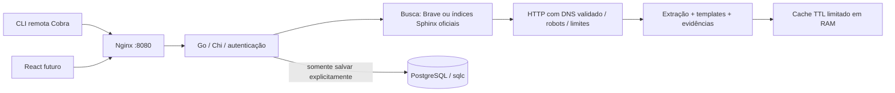

# Arquitetura

Nenhuma consulta entra em logs ou armazenamento automaticamente. PostgreSQL é utilizado
somente por salvos. Sessões e cache vivem em RAM. Reinício invalida sessões e cache.
Token CLI e senha web são segredos distintos, fornecidos pelo ambiente.
